        Практическая работа: Основные типы данных в языке Dart (Flutter Foundation)

    Тема 1. Числовые типы: int, double, num и математические операции 
Задания для закрепления
Конвертер валют: Напишите функцию, принимающую сумму в рублях (int) и курс доллара (double), возвращающую строку с результатом, отформатированным строго до 2 знаков после запятой.
Безопасный калькулятор возраста: Примите ввод пользователя в виде String. Используя int.tryParse(), верните возраст или -1, если пользователь ввел некорректный текст.
Расчет плотности пикселей (DP): Реализуйте формулу dp = px / density с использованием оператора целочисленного или дробного деления.
Побитовые флаги сенсоров: Используя побитовые операторы &, | и <<, закодируйте состояние трех мобильных датчиков в одну переменную int.
Проверка четности без остатка от деления: Проверьте, является ли целое число четным, используя побитовое умножение (number & 1) == 0.

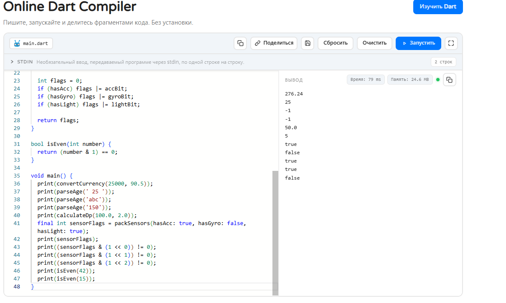

    Тема 2. Строки (String), интерполяция и кодовые точки (Runes)
Задания для закрепления
Маскирование email: Напишите функцию, преобразующую ivanov.flutter@gmail.com в i************r@gmail.com.
Валидатор префикса ссылки: Проверьте, начинается ли переданная строка с безопасного протокола https:// с помощью метода .startsWith().
Генератор инициалов (Monogram): Примите строку из двух слов («Александр Пушкин») и верните заглавные буквы «АП».
Разбор CSV-строки корзины: Разбейте строку вида "Яблоко,3,150.5" методом .split(',') и извлеките наименование, количество и стоимость.
Подсчет реальной длины строки с эмодзи: Напишите утилиту, которая считает точное количество символов в тексте с комбинированными эмодзи (через .runes).

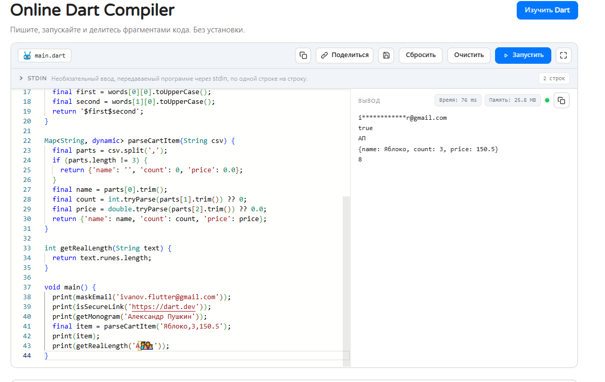

    Тема 3. Логический тип (bool) и строгость условий
Задания для закрепления
Проверка права доступа к экрану: Сформируйте булево выражение: пользователь авторизован, подтвердил email и не находится в списке заблокированных.
Определитель пустоты строки: Напишите функцию bool isBlank(String? input), возвращающую true, если строка равна null, пуста или состоит только из пробелов.
Тоггл состояния (Инвертор): Напишите функцию, переключающую флаг темной темы isDarkMode на противоположное значение.
Валидатор возраста для аренды авто: Проверьте совокупность условий: возраст (\ge 21) года И стаж вождения (\ge 2) лет.
Строгая фильтрация коллекций: Напишите проверку, что баланс пользователя строго положителен, избегая неявных сравнений.

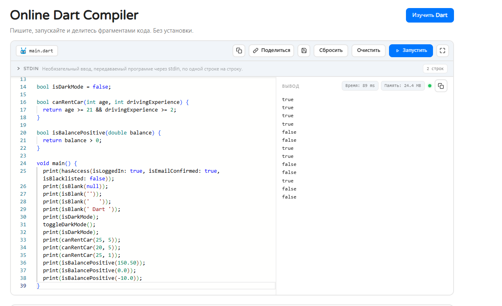

    Тема 4. Списки (List): списковые включения и spread-операторы
Задания для закрепления
Удаление дубликатов с сохранением порядка: Дан список List<int> с повторами. Верните список уникальных элементов через .toSet().toList().
Пагинация среза (Slice): Реализуйте метод getPage(List<T> list, int page, int pageSize), возвращающий соответствующий подсписок с помощью .sublist().
Сортировка товаров по цене: Дан список цен List<double>. Отсортируйте его по убыванию с помощью метода .sort().
Поиск первого подходящего элемента: Найдите в списке строк первое слово длиннее 8 символов с помощью .firstWhere(), обработав случай отсутствия через orElse.
Генератор виджетов через List.generate: Создайте список строк вида ["Слот 1", "Слот 2", ... "Слот 10"] с помощью конструктора List.generate().

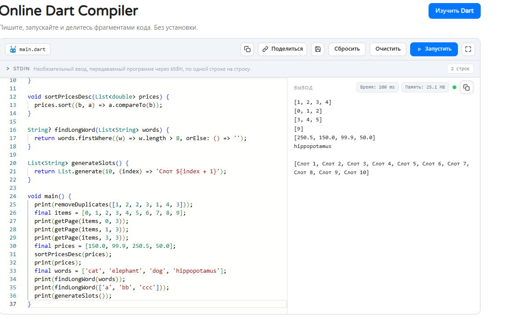

    Тема 5. Множества (Set) и Словари (Map): парсинг JSON-структур
Задания для закрепления
Подсчет частоты слов: Дана строка текста. С помощью Map<String, int> подсчитайте, сколько раз каждое слово встречается в тексте.
Симметрическая разность тегов: Найдите теги, которые присутствуют только в одном из двух множеств Set<String>, но не в обоих одновременно.
Безопасное извлечение настроек: Напишите функцию, извлекающую значение String из вложенной Map<String, dynamic> с гарантированным возвратом дефолтного значения при отсутствии ключа.
Трансформация карты (Map Entries): Преобразуйте Map<String, double> с ценами в рублях в карту с ценами в долларах с помощью .map().
Группировка пользователей по городу: Дан список карт пользователей. Сгруппируйте их в структуру Map<String, List<Map<String, dynamic>>>.

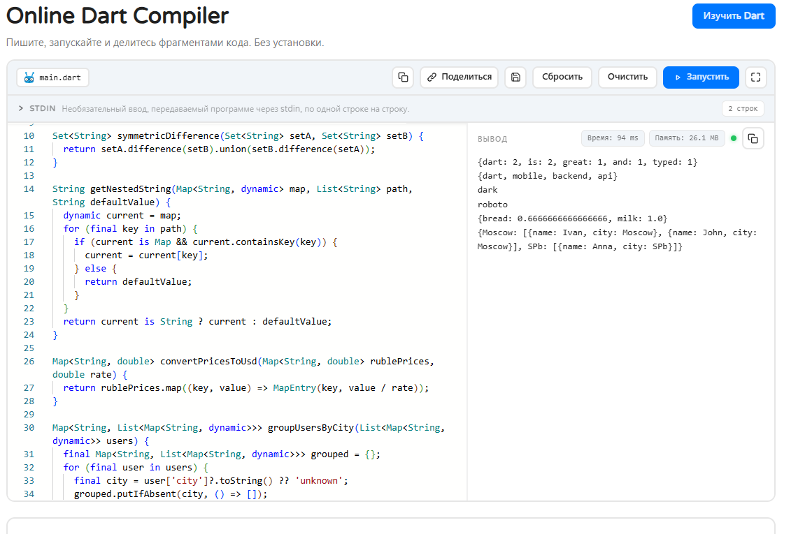

    Тема 6. Null Safety, Records (кортежи) и Pattern Matching
Задания для закрепления
Координаты экрана через Record: Напишите функцию, возвращающую кортеж (double x, double y) центра экрана смартфона.
Безопасная распаковка профиля: Дана переменная String? bio. Если она null, запишите в переменную displayBio текст «Информация отсутствует».
Pattern Matching над JSON: Используя конструкцию switch (json), проверьте формат входящего пакета: валидный объект с id или объект с полем ошибки.
Служебная переменная с late: Объявите переменную late final double expensiveCalculation, которая вычисляется только при первом реальном обращении.
Безопасный поиск в списке: Извлеките первый элемент списка List<int>? numbers через операторы ?.[0] и ?? -1.

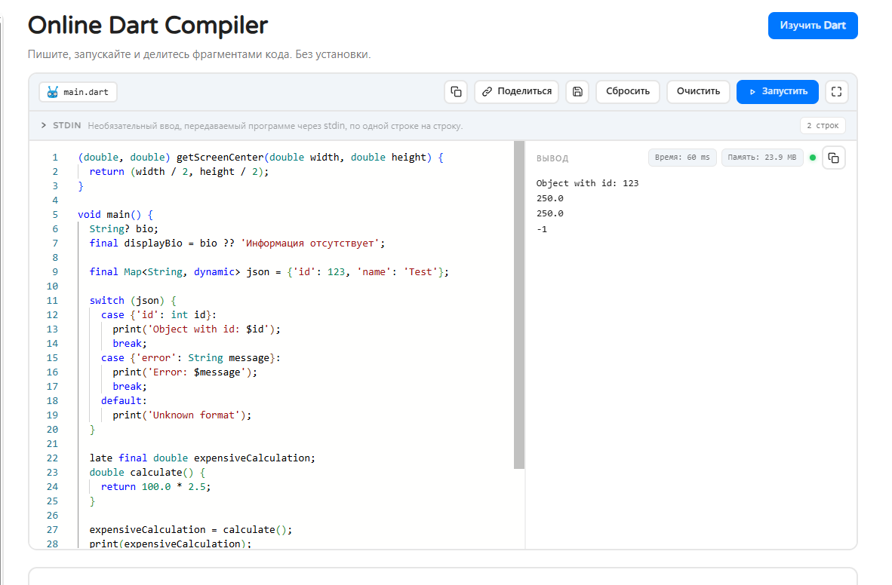

Блок 1: Числа, финансы и расчеты корзины (1–10)
Калькулятор скидки с промокодом: Рассчитайте итоговую стоимость заказа при условии: скидка 15%, но не более 500 рублей.
Форматирование цены по стандарту валют: Преобразуйте число 15400900.5 в строку "15 400 900.50 ₽".
Расчет кешбэка баллами: Начислите 1 балл за каждые полные 100 рублей чека, используя оператор целочисленного деления ~/.
Ограничитель диапазона (Clamp): Напишите функцию, ограничивающую уровень громкости динамика в диапазоне от 0.0 до 1.0.
Конвертер байтов в мегабайты: Преобразуйте размер файла из байтов в МБ с округлением до одного знака после запятой.
Вычисление процентного прогресса: По текущему шагу current и общему числу шагов total верните double от 0.0 до 1.0.
Округление до ближайшего десятка: Округлите переданное число вверх до ближайшего числа, кратного 10 (например, 43 -> 50).
Калькулятор стоимости доставки: Базовая ставка 200 руб. + 30 руб. за каждый километр свыше 5 км.
Проверка делимости без остатка: Определите, делится ли размер скачиваемого пакета ровно на блоки по 1024 байта.
Парсер диапазона цен: Извлеките минимальную и максимальную цену из строки "1500 - 4500 руб".

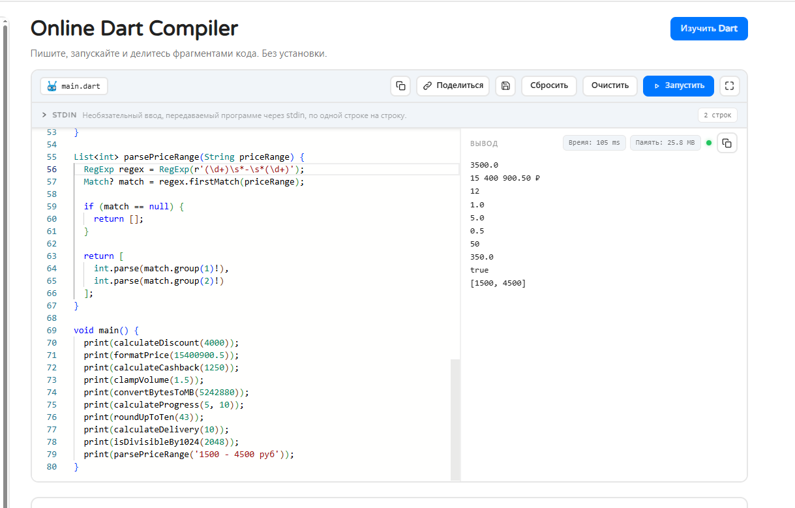

Блок 2: Строки, валидация полей и парсинг текста (11–20)
Валидатор пароля на регулярных выражениях: Проверьте пароль на наличие минимум 8 символов, одной цифры и одной заглавной буквы.
Очистка поискового ввода: Удалите из поискового запроса двойные пробелы, спецсимволы #, $, % и приведите к нижнему регистру.
Генератор сокращенного имени автора: Преобразуйте "Иванов Иван Иванович" в "Иванов И. И.".
Парсинг HEX-цвета для Flutter: Преобразуйте строку вида "#FF5722" в целочисленное значение цвета int (0xFFFF5722).
Форматирование таймера звонка: Переведите количество секунд int seconds = 125 в строку вида "02:05".
Скрытие номера телефона: Преобразуйте "+79991234567" в "+7 (999) ***-**-67".
Определитель языка текста (Кириллица/Латиница): Определите, содержит ли строка символы русского алфавита с помощью проверки диапазонов кодовых точек.
Генератор слага (Slugify): Преобразуйте заголовок статьи "Быстрый старт во Flutter!" в "bystryi-start-vo-flutter".
Подсчет слов в заметке: Подсчитайте количество слов в тексте заметки, разделенных пробелами и переносами строк.
Выделение тегов из текста: Извлеките все хештеги из сообщения блога (слова, начинающиеся с #).

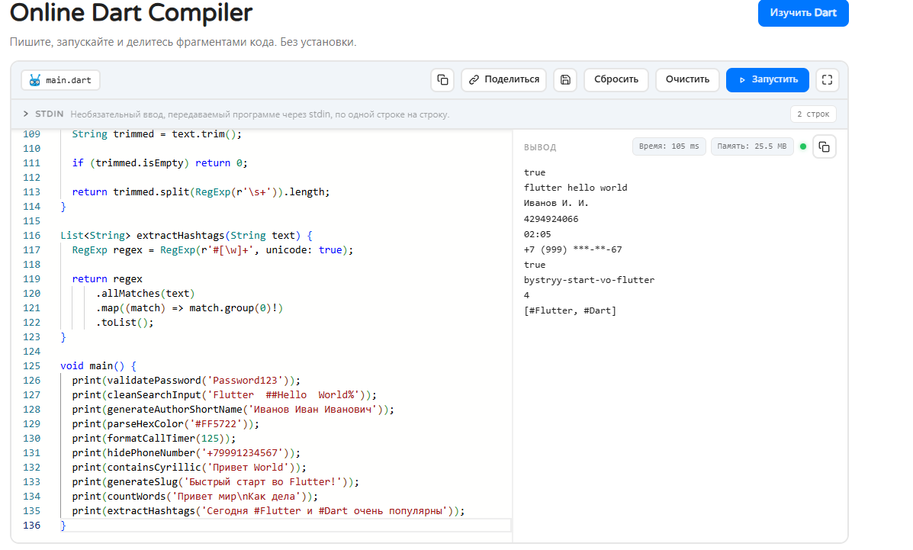

Блок 3: Списки, пагинация и фильтрация каталога (21–30)
Фильтр каталога по диапазону цен: Из списка карточек товаров отберите только те, у которых цена находится в заданном диапазоне.
Удаление завершенных задач из To-Do списка: Отфильтруйте список задач, оставив только элементы со статусом isCompleted == false.
Инверсия порядка чатов: Разверните список сообщений без создания промежуточных копий в памяти.
Склейка двух списков баннеров: Объедините системные промо-акции и персональные предложения с помощью spread-оператора ....
Поиск максимального элемента без библиотек: Найдите товар с наивысшим рейтингом в списке с помощью метода .reduce().
Чередование элементов списка: Вставьте рекламный баннер после каждого 5-го элемента ленты новостей.
Проверка идентичности двух списков: Напишите функцию, проверяющую, содержат ли два списка одинаковые элементы на тех же позициях.
Извлечение уникальных категорий: Из списка всех товаров магазина сформируйте List<String> уникальных названий категорий.
Сортировка списка по нескольким полям: Отсортируйте список товаров сначала по доступности на складе, а затем по возрастанию цены.
Постраничная группировка (Chunking): Разбейте длинный список из 100 элементов на пачки (страницы) по 10 элементов.

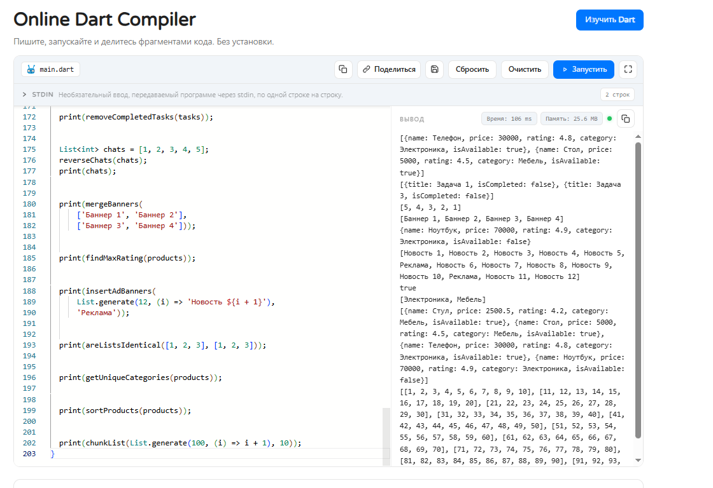

Блок 4: Map, JSON-сериализация и кэширование (31–40)
Десериализация профиля: Напишите парсер словаря Map<String, dynamic> в безопасные локальные переменные с дефолтными значениями.
Конвертация списка в ассоциативную карту: Преобразуйте List<User> в Map<int, User>, где ключом выступает уникальный id.
Слияние локального и серверного профиля: Объедините настройки приложения из кэша и свежие настройки с бэкенда с приоритетом сервера.
Удаление ключей с null-значениями: Очистите словарь от всех пар, где значение равно null, перед отправкой POST-запроса.
Кэш экранов (LRU-концепт): Реализуйте простейшую карту последних 5 открытых страниц, удаляя самый старый элемент при переполнении.
Инверсия карты (Значения становятся ключами): Поменяйте местами ключи и значения в словаре Map<String, String> (гарантируя уникальность).
Подсчет суммы товаров по категориям: На основе списка покупок верните Map<String, double>, где ключ — категория, а значение — общая сумма затрат.
Валидация обязательных JSON-полей: Проверьте, содержит ли карта ответа сервера ключи "status", "data" и "timestamp".
Построение дерева категорий: Преобразуйте плоский список категорий с parentId в иерархическую карту подкатегорий.
Сериализация параметров фильтра в URL: Соберите из словаря {"brand": "Apple", "minPrice": 50000} строку параметров brand=Apple&minPrice=50000.

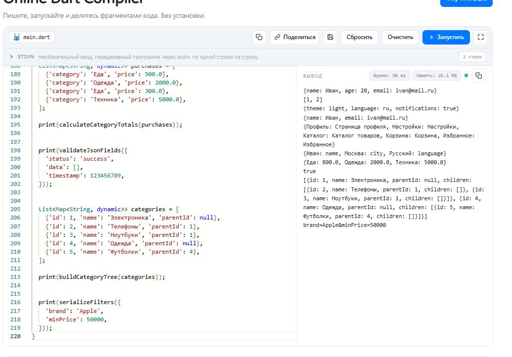

Блок 5: Sound Null Safety, Records и архитектурные пайплайны (41–50)
Парсер геолокации через Record: Напишите функцию, принимающую строку "54.01, 38.29" и возвращающую кортеж (double lat, double lon)?.
Резолвер состояний загрузки (Pattern Matching): С помощью switch верните текст сообщения для состояний (isLoading: true, hasError: false), (isLoading: false, hasError: true) и (isLoading: false, hasError: false).
Безопасная цепочка вызовов (Deep Null Traversal): Считайте улицу из вложенного объекта компании: user?.company?.address?.street ?? "Адрес не указан".
Сопоставление типа ответа API: Напишите функцию обработки ответа через сопоставление типов: case int code, case String error, case Map data.
Деструктуризация координат точки в цикле: Пройдитесь по списку кортежей List<(int x, int y)> с прямой деструктуризацией for (var (x, y) in points).
Обмен значений двух переменных без третьей: Поменяйте местами значения переменных a и b с помощью синтаксиса кортежей: (a, b) = (b, a).
Валидатор комплексной формы регистрации: Функция возвращает Record ({bool isValid, List<String> errors}) с перечнем всех найденных ошибок формы.
Обработка диапазона громкости через Switch Guard: Используйте паттерн с условием when: case int v when v > 80 => "Слишком громко!".
Пайплайн очистки телефонной книги: Дан список List<String?> с поврежденными записями. Очистите его от null, пустых строк и верните Set<String> уникальных нормализованных номеров.
Итоговый аналитический модуль корзины:
Примите корзину покупок в виде List<Map<String, dynamic>>.
Рассчитайте общую стоимость позиций с учетом индивидуальных скидок.
Выделите категории товаров и проверьте бесплатность доставки (от 2000 руб.).
Верните результат в виде именованного кортежа ({double total, double discountAmount, bool isFreeDelivery}).

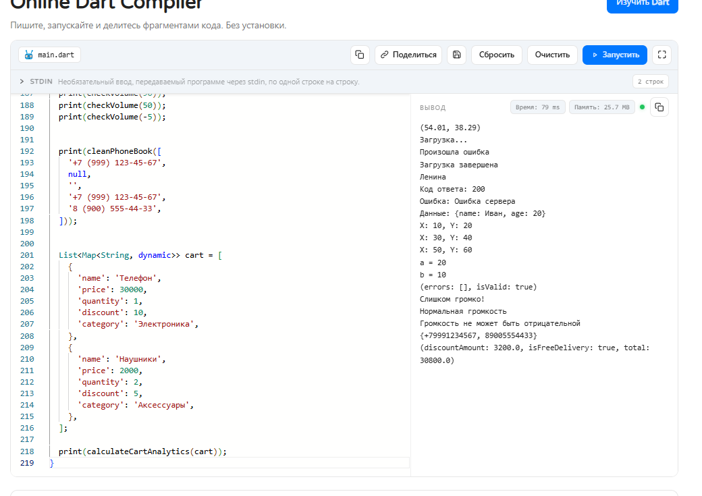