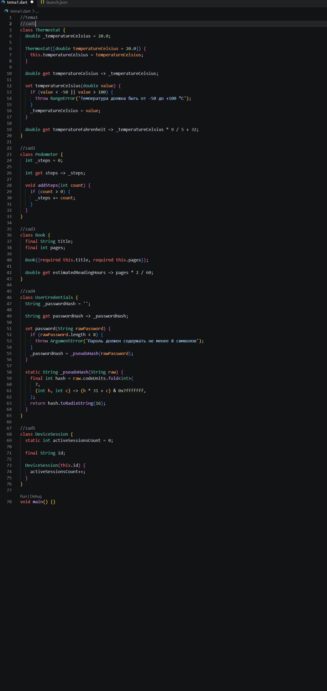
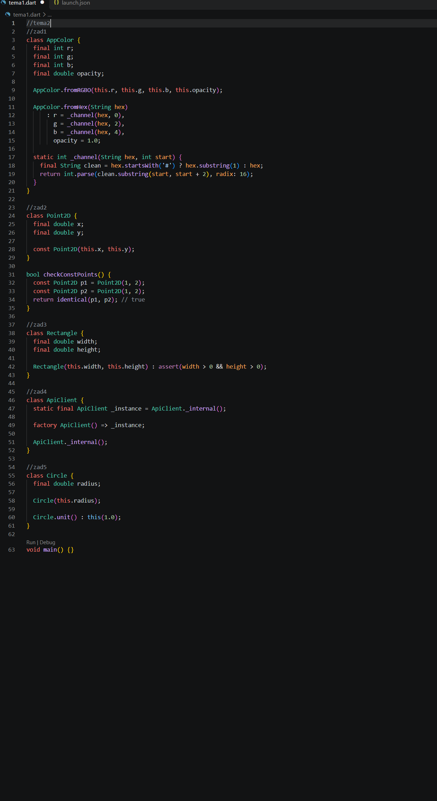
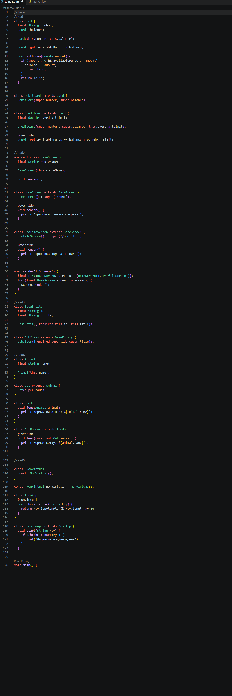
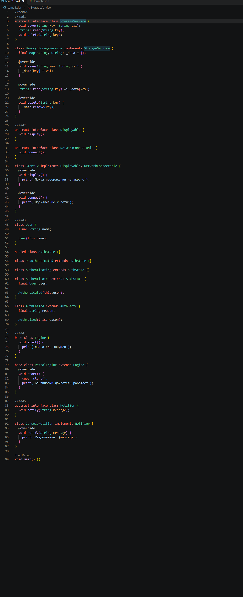
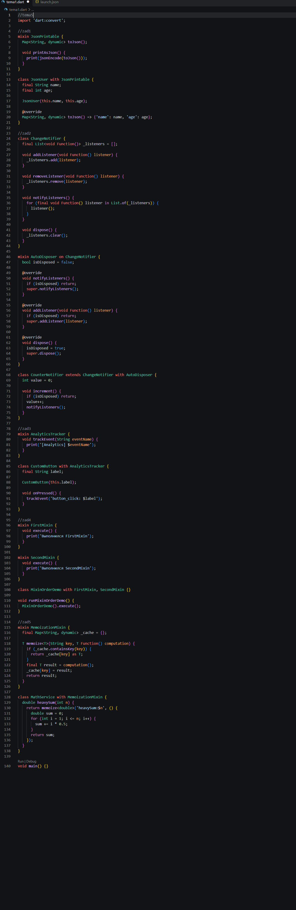
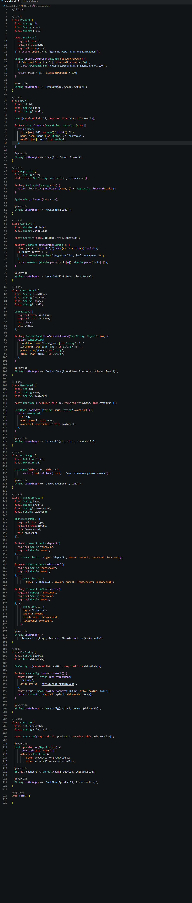
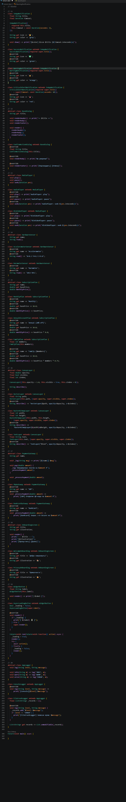
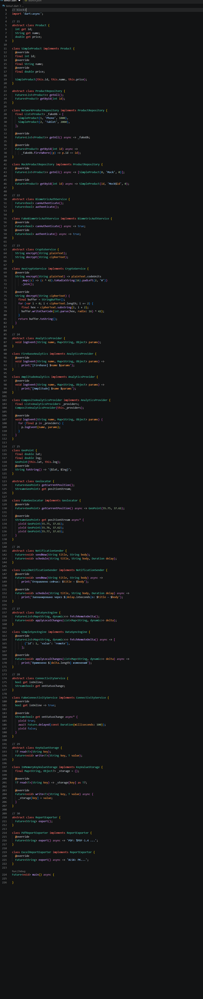
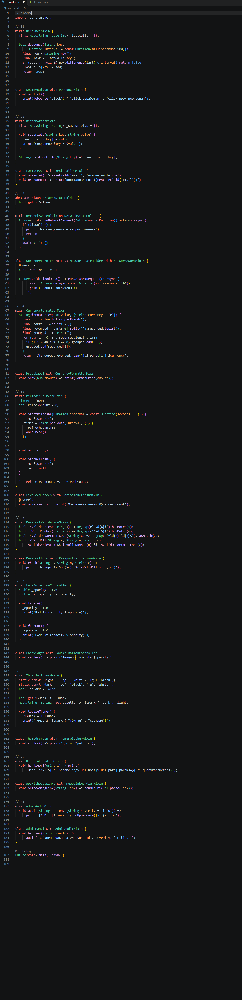
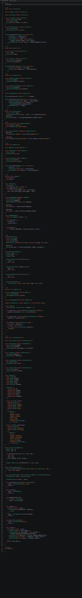

Практическая работа: Объектно-ориентированное программирование в Dart (Flutter Architecture)

     Тема 1. Классы, инкапсуляция, методы и геттеры/сеттеры

    Тема 2. Все виды конструкторов: Named, Initializer List, Factory, Const

    Тема 3. Наследование (extends), полиморфизм и super 

  Тема 4. Абстрактные классы, неявные интерфейсы (implements) и Sealed-классы

   Тема 5. Миксины (Mixins): композиция поведения через with и on

Блок 1: Модели данных, DTO и конструкторы

Блок 2: Наследование и иерархия UI-компонентов

Блок 3: Абстрактные контракты, интерфейсы и репозитории

Блок 4: Миксины и повторное использование функционала

Блок 5: Современные модификаторы классов и архитектурные стейты

